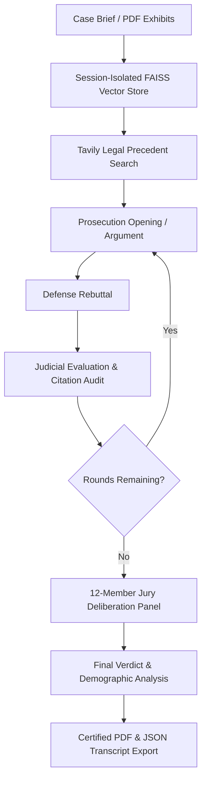

<div align="center">
  
  <h1>⚖️ CourtRoom AI</h1>
  <h3>Autonomous Legal Trial Simulation &amp; Deliberation Platform</h3>

  <p align="center">
    <b>FastAPI Backend &bull; LangGraph Multi-Agent Engine &bull; Modern React/Vite Courtroom Web App</b>
    <br/>
    <a href="#about">About</a> &bull;
    <a href="#features">Features</a> &bull;
    <a href="#architecture">Architecture</a> &bull;
    <a href="#quickstart">Quickstart</a> &bull;
    <a href="#testing">Testing</a> &bull;
    <a href="#api-reference">API Reference</a>
  </p>
</div>

---

## 🏛️ About
**CourtRoom AI** is a legal trial simulation platform designed to model adversarial prosecution, defense counter-arguments, judicial review with citation grounding, and an interactive 12-member jury deliberation panel.

Users can supply a case brief or upload supporting PDF exhibits. The platform indexes evidence into an isolated session vector store, retrieves relevant precedents, and runs an autonomous adversarial courtroom proceeding in real time with live streaming telemetry.

---

## 🔥 Key Features

- 🎯 **Adversarial Legal Podiums:** Autonomous Lead Prosecutor and Senior Defense Counsel generate stage-aware legal briefs (Opening Statements, Rebuttals, and Closing Arguments) with strategy tagging and self-assessed confidence metrics.
- 👨‍⚖️ **Judicial Review & Scorecard:** A presiding judge agent scores each side across four dimensions: *Legal Soundness*, *Evidence Quality*, *Logical Coherence*, and *Precedent Accuracy*.
- 🔎 **Citation Grounding & Audit:** Real-time Tavily search verifies cited statutes and judicial authorities, flagging hallucinated citations.
- 👥 **Interactive 12-Juror Deliberation Box:** A demographically and psychologically diverse jury panel (evaluating age, occupation, empathy, and skepticism metrics) deliberates to render individual verdicts and reasoning.
- ⚡ **Real-Time SSE Streaming:** Live Server-Sent Events (SSE) update the courtroom timeline stage-by-stage without page reloads or UI freezing.
- 📑 **Certified PDF Transcript Export:** Generates multi-page, formatted legal trial transcripts with crash-proof XML escaping.
- 🛡️ **Session-Isolated RAG:** Documents uploaded for a trial are isolated per session ID, preventing cross-trial context contamination.
- ⚡ **Instant Recorded Demos:** Built-in instant preview for landmark simulations (*Wall Street Insider Trading* &amp; *Satyam Financial Fraud*).

---

## 🛠️ Architecture



---

## 🚀 Quickstart

### 1. Prerequisites
- Python 3.11+
- Node.js 18+ (for frontend development)

### 2. Environment Setup
Create a `.env` file from `.env.example`:
```bash
cp .env.example .env
```

Add your API keys in `.env`:
```env
GROQ_API_KEY="your_groq_api_key_here"
TAVILY_API_KEY="your_tavily_api_key_here"
LANGCHAIN_API_KEY="your_langsmith_key_here"  # Optional: For LangSmith tracing
LANGCHAIN_TRACING_V2=true
LANGCHAIN_PROJECT=courtroom-ai
```

### 3. Install Python Dependencies
```bash
pip install -r requirements.txt
```

### 4. Run CourtRoom AI
Start the unified application (FastAPI server serving the built web app):
```bash
python main.py
```
Open **[http://localhost:8000](http://localhost:8000)** in your browser!

Interactive API documentation (Swagger) is available at **[http://localhost:8000/docs](http://localhost:8000/docs)**.

---

## 💻 Development Workflow

### Running Backend with Hot Reload:
```bash
python main.py --reload
# or: uvicorn server.app:app --reload --port 8000
```

### Running Frontend Vite Dev Server:
```bash
cd frontend
npm install
npm run dev
```
The frontend dev server runs at **[http://localhost:5173](http://localhost:5173)** and automatically proxies `/api` calls to the FastAPI backend at port 8000.

### Building Frontend for Production:
```bash
cd frontend
npm run build
```
Build outputs are placed in `frontend/dist/` and automatically served by FastAPI on root `/`.

### Legacy Streamlit UI:
If you need to access the legacy Streamlit interface:
```bash
python main.py --streamlit
# or: streamlit run ui/app.py
```

---

## 🧪 Testing

CourtRoom AI includes a comprehensive automated test suite covering agent utilities, JSON schemas, citation extraction, LangGraph routing, RAG session isolation, and FastAPI REST endpoints.

Run tests using pytest:
```bash
pytest -v
```

---

## 📡 API Reference

| Endpoint | Method | Description |
| :--- | :--- | :--- |
| `/api/health` | `GET` | System health check and API key validation |
| `/api/cases/samples` | `GET` | List pre-configured benchmark cases |
| `/api/cases/cached` | `GET` | List instant pre-recorded demo cases |
| `/api/cases/load-cached/{filename}` | `POST` | Load a pre-recorded demo simulation |
| `/api/trials` | `POST` | Initialize a new trial and upload PDF exhibits |
| `/api/trials/{id}/start` | `POST` | Explicitly launch an initialized trial run |
| `/api/trials/{id}/status` | `GET` | Lightweight monitoring telemetry and runtime stage status |
| `/api/trials/{id}/stages` | `GET` | Structured stage outputs (arguments, scores, verdicts) |
| `/api/trials/{id}` | `GET` | Fetch complete trial state record |
| `/api/trials/{id}/stream` | `GET` | Server-Sent Events (SSE) stream for live simulation |
| `/api/trials/{id}/export/pdf` | `GET` | Download certified PDF trial transcript |
| `/api/trials/{id}/export/json` | `GET` | Download full trial state JSON |

---

<p align="center">
  <i>Developed for legal argument simulation, education, and precedent review. Not intended for actual legal advice or judicial replacement.</i>
</p>
