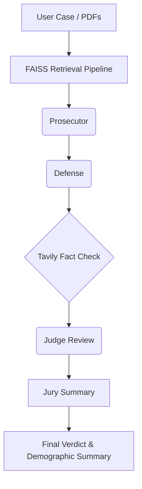

<div align="center">
  
  <h1>⚖️ CourtRoom AI</h1>
  <h3>Legal argument simulation with evidence review</h3>

  <p align="center">
    <b>Powered by LangGraph, Tavily Search, & FAISS Vector Search</b>
    <br/>
    <a href="#about">About</a> &bull;
    <a href="#features">Features</a> &bull;
    <a href="#architecture">Architecture</a> &bull;
    <a href="#installation">Installation</a> &bull;
    <a href="#usage">Usage</a>
  </p>
</div>

---

## 🏛️ About
**CourtRoom AI** is a legal simulation platform designed to model prosecution and defense argument generation, evidence retrieval, and citation review.

By supplying a case scenario or uploading supporting documents, the system uses retrieval-augmented text analysis to produce structured arguments, compare them, and summarize a mock jury outcome. A judge review step checks argument strength and citation reliability before the jury summary is produced.

This tool is intended for testing legal reasoning workflows and reviewing how evidence and legal precedent can be assembled in a structured format.

---

## 🔥 Features
- 🎯 **Structured Legal Roles:** Separate prosecution, defense, judge review, and jury summary stages for clearer workflow analysis.
- 🗂️ **Document Retrieval:** Upload PDFs or enter case text. The system converts content into searchable chunks and uses FAISS for relevant context retrieval.
- 🔎 **Citation and Evidence Review:** A judge review step checks argument coherence and citation reliability using external search results.
- 👥 **Jury Summary:** Generates a jury outcome with individual verdicts and reasoning based on a mix of juror profiles.
- 📑 **Transcript Export:** Produces a downloadable PDF summary of the case, arguments, judge findings, and jury results.

---

## 🛠️ Architecture

System architecture:
* **Orchestration:** `LangGraph` and `LangChain`
* **External Search:** `Tavily` Search API
* **Vector Store:** `FAISS-CPU` + MiniLM Embeddings
* **User Interface:** `Streamlit`



---

## 🚀 Installation

Ensure you have Python 3.10+ installed. Virtual environments are highly recommended via `uv` or `venv`.

```bash
# 1. Clone the repository
git clone https://github.com/yourusername/courtroomai.git
cd courtroomai

# 2. Create virtual environment and install dependencies
uv venv 
.\.venv\Scripts\activate   # (or source .venv/bin/activate on Mac/Linux)
uv pip install -r requirements.txt

# 3. Setup environment variables
cp .env.example .env
```

**Inside your `.env` file, you must include:**
```env
GROQ_API_KEY="your_groq_key_here"
TAVILY_API_KEY="your_tavily_key_here"
LANGCHAIN_API_KEY="your_langsmith_key_here" # Optional: For LangSmith Tracing
LANGCHAIN_TRACING_V2="true"
LANGCHAIN_PROJECT="courtroomai"
```

---

## 🖥️ Usage

Boot the application using Streamlit. To ensure Python module pathing works flawlessly, use python module running or `uv run`:

```bash
uv run streamlit run ui/app.py
```

### Loading Sample Cases
If you don't have a case to type out, simply use the sidebar dropdown to load one of the built-in simulations:
- **Insider Trading**
- **Corporate Fraud** (Theranos-style)
- **IP Theft & Trade Secrets** (LiDAR technology espionage)

Once the run completes, download your generated **PDF Trial Transcript** straight from the UI!

---

## 🔮 Future Roadmap & Planned Updates
- 📡 **Live Legal Database Integration:** Direct API connections to real-world legal databases (e.g., PACER, CourtListener) for live case retrieval and citation validation.
- 🖼️ **Multi-Modal Evidence Ingestion:** Allow agents to analyze image-based evidence, audio transcripts, and visual exhibits during the trial.
- 🧑‍⚖️ **Customizable Judge Personas:** Toggle the presiding judge's judicial philosophy (e.g., Strict Textualist, Pragmatist) to observe its impact on the trial outcome.
- 📊 **Advanced Jury Analytics:** Heatmaps, demographic clustering, and explainable AI metrics detailing exactly *why* specific jury demographics voted the way they did.
- 💾 **State Persistence:** Ability to pause, save, and resume long-running simulated trials.
- 🔌 **Expanded Local Model Support:** Out-of-the-box integration for local `Ollama` models to run fully private, offline courtroom simulations.

---

<p align="center">
  <i>Developed as a legal reasoning and review tool. Not intended for actual legal advice or judicial replacement.</i>
</p>
